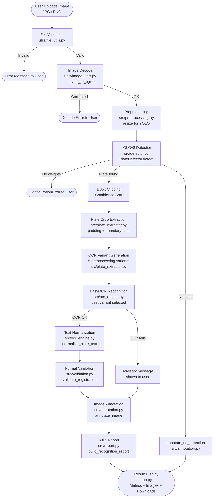

# System Architecture — Vehicle Number Plate Recognition System

---

## Architecture Overview

The ALPR system is built as a set of loosely coupled Python modules. The Streamlit
application (`app.py`) acts as the presentation layer; the `src/` package contains
the processing pipeline; `utils/` provides shared helpers; `config.py` centralizes
all tunable parameters.

---

## Module Interaction Flowchart



---

## Module Responsibility Table

| File | Author | Function |
|------|--------|---------|
| `config.py` | Abhayvir Singh | Centralized configuration from env vars |
| `src/pipeline.py` | Abhayvir Singh | End-to-end orchestration |
| `src/detector.py` | Abhayvir Singh | YOLOv8 inference, PlateDetection dataclass |
| `src/preprocessing.py` | Abhayvir Singh | CLAHE, thresholding, resize, sharpening |
| `src/plate_extractor.py` | Abhayvir Singh | Safe crop extraction with padding |
| `src/ocr_engine.py` | Himank Devnani | EasyOCR wrapper, multi-variant selection |
| `src/validation.py` | Himank Devnani | Indian plate format heuristics |
| `src/annotation.py` | Karam Singh Bana | Bounding box + label drawing |
| `src/report.py` | Karam Singh Bana | JSON/CSV report, session history |
| `app.py` | Karam Singh Bana | Streamlit multi-page UI |
| `utils/image_utils.py` | Karam Singh Bana | PIL↔BGR conversion, resize |
| `utils/file_utils.py` | Karam Singh Bana | Upload validation, CSV/JSON helpers |

---

## Data Flow

1. **Raw bytes** arrive from the Streamlit file uploader.
2. `validate_upload()` checks extension, size, and emptiness.
3. `bytes_to_bgr()` decodes the bytes into an OpenCV BGR array.
4. `preprocess_for_detection()` downsizes very large images to protect memory.
5. `PlateDetector.detect()` passes the array to YOLOv8; the result is a list of
   `PlateDetection` objects (bbox, confidence, class_name).
6. `extract_plate_crop()` slices the detected region with padding from the full image.
7. `get_ocr_variants()` generates 5 preprocessed versions of the crop.
8. `EasyOCREngine.recognize()` runs EasyOCR on each variant and returns the
   `OCRResult` with the highest average word confidence.
9. `normalize_plate_text()` uppercases the text and strips illegal characters.
10. `validate_registration()` applies heuristic Indian format matching.
11. `annotate_image()` draws bounding boxes and labels on a copy of the original.
12. `build_recognition_report()` packages all results into a dict.
13. Streamlit renders images, metrics, and download buttons.

---

## Configuration Architecture

All tuneable values are in `config.py`, which reads from environment variables
(set via `.env` or shell). No magic numbers are scattered through source files.

```
.env / environment
      ↓
  config.py
      ↓
  ┌───┴────┐
  detector  ocr_engine  pipeline  app
```

---

## Error Isolation Strategy

Each stage of the pipeline is wrapped in `try/except`. A failure at any stage
produces a descriptive `error_message` and a `user_message` in the
`PipelineResult`. The Streamlit UI reads these fields and shows appropriate
error banners. Failures never silently show a stale previous result.
